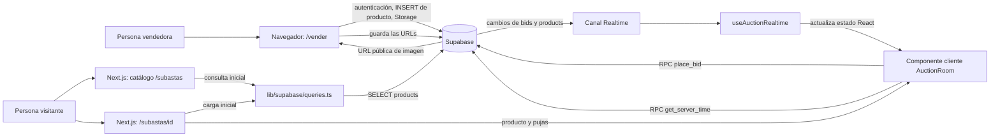

# Subastas en Vindex

Esta guía explica las subastas de Vindex desde dos perspectivas: qué ve una persona que participa y cómo se conectan las páginas, los componentes React y Supabase. Está pensada para lectores que recién comienzan con Next.js, React o bases de datos.

Se documenta el comportamiento que se observa en el código web del repositorio. La definición SQL de algunas funciones y triggers de Supabase no está incluida en este checkout; cuando una regla depende de esa configuración, se indica explícitamente como una dependencia que debe verificarse en el proyecto Supabase.

## Antes de leer el código

Una subasta es una publicación de producto cuyo precio final todavía no está definido. El vendedor propone un precio inicial y una duración; las personas interesadas envían pujas. La oferta más alta pasa a ser la oferta vigente y, al terminar el plazo, el perfil asociado a `winner_id` es el ganador registrado.

Algunos términos usados en esta guía:

| Término | Significado en esta funcionalidad |
| --- | --- |
| Página de servidor | Código Next.js que obtiene datos antes de entregar la página al navegador. Aquí se cargan los datos iniciales. |
| Componente cliente | Componente React que se ejecuta en el navegador y puede reaccionar a clics, mantener estado o abrir Realtime. Se identifica con `"use client"`. |
| Hook | Función React reutilizable que agrupa comportamiento con estado o efectos, por ejemplo suscribirse a eventos o actualizar un contador. |
| Consulta | Lectura de tablas de Supabase, por ejemplo buscar subastas activas. |
| RPC | Función de PostgreSQL invocada con `supabase.rpc(...)`. Para pujar, el navegador llama a `place_bid` en vez de insertar directamente en `bids`. |
| Realtime | Servicio que notifica cambios de PostgreSQL a los navegadores suscritos. En Vindex se usa dentro de una sala individual, no en el catálogo. |
| RLS | Reglas de PostgreSQL que limitan qué filas puede leer o modificar cada sesión. El navegador no debe considerarse confiable: RLS y las funciones de base de datos son parte de la protección. |
| Trigger | Código de PostgreSQL que se ejecuta automáticamente ante una operación en una tabla. Puede reforzar reglas aunque una solicitud no provenga de la interfaz web. |

## Mapa general

Este dibujo resume las responsabilidades. Las flechas representan llamadas o eventos, no una conexión permanente en todas las páginas.



En resumen: Next.js prepara los datos iniciales; el navegador hace interactiva la sala; PostgreSQL conserva el estado oficial; y Realtime avisa a las salas abiertas cuando ese estado cambia.

## Resumen del flujo

1. El vendedor publica un producto como subasta desde `/vender`.
2. La aplicación crea una fila en `public.products` con `sale_type = 'auction'` y los valores propios de la subasta.
3. El catálogo `/subastas` y el bloque de subastas destacadas del Home consultan subastas activas mediante peticiones normales. No crean conexiones Realtime.
4. La sala `/subastas/[id]` carga el producto, el perfil del vendedor y las pujas recientes desde el servidor.
5. En la sala, el cliente abre un canal Realtime filtrado para ese producto. Los INSERT de `bids` actualizan el historial y el monto; los UPDATE de `products` sincronizan la puja actual y el vencimiento.
6. Para registrar una oferta, el cliente llama a la función RPC transaccional `place_bid`. No se insertan filas en `bids` directamente desde el navegador.

## Modelo de datos

### `public.products`

Las subastas se distinguen con `sale_type = 'auction'`. Los campos relevantes son:

| Campo | Uso |
| --- | --- |
| `id` (`BIGINT`) | Identificador de producto/subasta. En la aplicación se maneja como `number`. |
| `seller_id` (`UUID`) | Perfil propietario, relacionado con `public.profiles(id)`. |
| `name`, `description`, `condition`, `images` | Información mostrada en el detalle y catálogo. `images` contiene URLs públicas. |
| `stock` | Cantidad publicada. El formulario requiere al menos una unidad para una subasta. |
| `sale_type` | Debe ser `auction` para aparecer como subasta. |
| `is_auction` | Indicador compatible con el esquema existente. Se establece en `true` al publicar una subasta. |
| `starting_price` (`NUMERIC`) | Precio inicial configurado por el vendedor. |
| `current_bid` (`NUMERIC`) | Oferta vigente; parte en `NULL` y se establece al recibirse una puja. |
| `bid_increment` (`NUMERIC`) | Incremento mínimo positivo entre ofertas. |
| `auction_ends_at` (`TIMESTAMPTZ`) | Fecha de cierre, calculada según la duración elegida. |
| `winner_id` (`UUID`) | Perfil ganador, inicialmente `NULL`. |
| `status` (`BOOLEAN`) | `true` significa publicación activa. Retirar una publicación usa baja lógica, `status = false`. |

Para una publicación de subasta, `price`, `discount_price` y `offer_ends_at` quedan nulos; el valor inicial se almacena en `starting_price`. Los campos propios de la subasta quedan nulos en una venta directa.

### `public.bids`

Cada oferta contiene:

| Campo | Uso |
| --- | --- |
| `id` | Identificador de la puja. El formateador de cliente lo normaliza como `string` para usarlo como clave estable. |
| `product_id` (`BIGINT`) | Subasta a la que pertenece. |
| `bidder_id` (`UUID`) | Perfil del postor. La FK `fk_bids_profiles` apunta a `public.profiles(id)`. |
| `amount` (`NUMERIC`) | Monto ofrecido. |
| `created_at` | Fecha y hora de la oferta. |

La consulta de pujas carga el nombre mediante la relación explícita `profiles:profiles!fk_bids_profiles(full_name)`. Si no hay nombre de perfil disponible, la sala muestra `Postor Anónimo`; para identificar la propia oferta, muestra `Tu puja`.

## Publicar una subasta

En [la página de venta](../apps/web/app/vender/page.tsx), el vendedor activa **Publicar como subasta** y completa:

- Precio inicial (`starting_price`), expresado como pesos enteros y mayor que cero.
- Incremento mínimo (`bid_increment`), positivo y no superior al 50% del precio inicial. Así queda espacio para aceptar la siguiente puja dentro del límite.
- Duración (5 minutos para pruebas, 24 o 48 horas, 7 o 14 días); de ella se calcula `auction_ends_at`.
- Stock, condición, descripción, imágenes y disponibilidad de envío.

Al guardar se crea la fila en `products` con `sale_type = 'auction'`, `is_auction = true`, `current_bid = NULL` y `winner_id = NULL`. El canal no se crea durante la publicación ni en el catálogo.

## Catálogo

La ruta [app/subastas/page.tsx](../apps/web/app/subastas/page.tsx) usa `getActiveAuctions()` desde [queries.ts](../apps/web/lib/supabase/queries.ts). La consulta obtiene productos activos (`status = true`) de tipo subasta cuya fecha `auction_ends_at` sea posterior al momento actual, y los ordena por vencimiento.

Las tarjetas se implementan en [AuctionCard.tsx](../apps/web/components/auctions/AuctionCard.tsx). Muestran imagen, nombre, oferta actual —`current_bid` o `starting_price` si aún no hay ofertas— y tiempo restante. [AuctionCountdown.tsx](../apps/web/components/auctions/AuctionCountdown.tsx) actualiza la cuenta regresiva localmente cada segundo y señala como «Por finalizar» los últimos tres minutos.

El bloque «Subastas populares» del Home usa [PopularAuctions.tsx](../apps/web/components/PopularAuctions.tsx) y la misma consulta normal. Ninguna de estas listas crea canales WebSocket.

## Sala de subasta

La ruta [app/subastas/[id]/page.tsx](../apps/web/app/subastas/[id]/page.tsx):

1. Valida que el ID de la ruta sea un entero positivo seguro.
2. Carga el producto con `getAuctionById()`, incluyendo el perfil del vendedor mediante `fk_products_profiles`.
3. Carga hasta 20 pujas iniciales mediante `getAuctionBids()`, en orden `created_at DESC`, con el JOIN a `profiles` por `fk_bids_profiles`.
4. Carga el nombre del ganador, cuando ya existe.
5. Entrega esos datos a [AuctionRoom.tsx](../apps/web/components/auctions/AuctionRoom.tsx).

La sala muestra la galería, descripción, condición, vendedor, oferta vigente, rango permitido para la siguiente puja, tiempo restante y pujas recientes. El mínimo se calcula como `current_bid + bid_increment`; si aún no hay ofertas, se usa `starting_price`. El máximo es `floor(monto vigente × 1,5)`; antes de la primera puja, el monto vigente es `starting_price`. Por ejemplo, si el monto vigente es $500.000, una puja de $6.000.000.000 se rechaza y el tope de ese turno es $750.000. Los límites se recalculan al recibir cambios por Realtime. Una puja solo se acepta dentro del rango inclusivo; los botones de puja rápida que superen el máximo se deshabilitan.

El hook [useSynchronizedTimer.ts](../apps/web/hooks/useSynchronizedTimer.ts) sincroniza la hora con la RPC `public.get_server_time()` (milisegundos desde Unix epoch) y calcula el contador con un reloj monotónico local compensado por la diferencia estimada con el servidor. Reintenta la sincronización cada 30 segundos y recalcula el vencimiento al cambiar `auction_ends_at` por Realtime. Mientras no haya una sincronización válida, muestra un skeleton y mantiene deshabilitadas las pujas. Dentro de los últimos 180 segundos muestra la zona anti-sniping; al llegar a cero, cierra el formulario y presenta el ganador actual.

La regla de límites también debe estar protegida en PostgreSQL. El diseño descrito para el sistema usa una validación `BEFORE INSERT` en `public.bids` que verifica la subasta, el incremento y el máximo, y bloquea la fila del producto para evitar que dos pujas simultáneas validen contra el mismo estado antiguo. La validación del navegador mejora la experiencia, pero no sustituye esta protección de base de datos.

**Importante:** el directorio `supabase/migrations/` de este checkout está vacío. Por eso no es posible revisar aquí el SQL de esa validación ni confirmar que esté desplegada en Supabase. Antes de operar o publicar cambios, verifica la función, el trigger y sus permisos en el proyecto Supabase; conviene guardar el SQL en una migración versionada del repositorio.

### Protección anti-sniping

La protección anti-sniping busca evitar que una puja enviada justo al final deje a las demás personas sin tiempo para responder. El comportamiento esperado es que una puja válida cerca del cierre extienda `auction_ends_at` cinco minutos; otra puja tardía puede volver a extenderlo. El cambio debe hacerse en PostgreSQL y propagarse a las salas mediante el UPDATE de `products`.

El navegador tiene dos umbrales relacionados, pero distintos: la sala marca visualmente como urgente el tiempo restante de 180 segundos o menos; el hook de Realtime considera hasta 210 segundos al decidir si debe volver a consultar el cierre después de una puja tardía. Esos 30 segundos adicionales coinciden con la tolerancia descrita para el reloj de la base de datos. Ninguno de esos valores, por sí solo, implementa la extensión: hace falta el trigger configurado en Supabase.

**Dependencia externa:** no hay SQL de anti-sniping ni migraciones en `supabase/migrations/` en este checkout. La aplicación web puede detectar que el cierre no se extendió y mostrar una advertencia, pero no puede extenderlo de forma segura por sí sola. Verifica en Supabase que el trigger exista y que compare correctamente `products.status`.

Al llegar el contador a cero, se deshabilita el formulario y se presenta el ganador si `winner_id` está definido. El ganador se consulta en `public.profiles`.

### Envío de una puja

La sala invoca exclusivamente esta RPC:

```ts
const { error } = await supabase.rpc("place_bid", {
  p_product_id: product.id,
  p_bid_amount: amount,
});
```

La RPC registra la puja de forma transaccional y el trigger `enforce_auction_bid_limits_before_insert` vuelve a verificar los importes contra el estado vigente bajo bloqueo de fila. La interfaz también impide enviar montos fuera del rango, presenta el estado de carga y muestra errores devueltos por Supabase. Tras una puja confirmada, el cliente consulta el estado actual de `products` para sincronizar de inmediato el vencimiento de quien ofertó; el canal Realtime sigue sincronizando a los demás participantes. Si la puja fue durante los últimos tres minutos y Supabase devuelve el mismo vencimiento, la interfaz advierte que la extensión no se reflejó en la base de datos.

## Supabase Realtime

El hook [useAuctionRealtime.ts](../apps/web/hooks/useAuctionRealtime.ts) pertenece únicamente a la sala. Crea un canal por producto (`auction-room-${productId}`) y registra dos suscripciones:

- `public.bids`, evento `INSERT`, filtrado por `product_id=eq.<productId>`.
- `public.products`, evento `UPDATE`, filtrado por `id=eq.<productId>`.

Al insertar una puja, el hook:

1. Registra el payload crudo para diagnóstico.
2. Normaliza el objeto y valida sus campos con `formatAuctionBid()`.
3. Consulta el nombre del postor en `public.profiles`; si no está disponible, conserva un fallback.
4. Inserta la puja al inicio del estado, evitando duplicados por ID.
5. Actualiza localmente `current_bid`.

Si `payload.new` llega vacío o incompleto, consulta la última puja de la subasta ordenada por `created_at DESC` y aplica la misma normalización y deduplicación. El UPDATE de `products` sincroniza `current_bid`, `auction_ends_at` y `winner_id`, incluido un eventual ajuste anti-sniping.

El hook registra el estado de suscripción (`SUBSCRIBED`, `CHANNEL_ERROR`, `TIMED_OUT`) y los errores en consola. Al desmontar la sala, retira el canal mediante `supabase.removeChannel(channel)`.

### Requisitos de Supabase

- `public.products` y `public.bids` deben estar en la publicación `supabase_realtime`.
- Debe existir la RPC transaccional `public.place_bid` con parámetros `p_product_id` y `p_bid_amount`.
- Debe existir `public.get_server_time()` y devolver la hora actual del servidor como milisegundos desde Unix epoch; los clientes de la sala necesitan permiso para ejecutarla.
- La RPC `place_bid` debe aplicar las reglas de negocio en PostgreSQL; el SQL de esa RPC y de los triggers de validación no está versionado en el directorio `supabase/migrations/` de este checkout, por lo que su despliegue debe comprobarse directamente en Supabase.
- Debe existir la clave foránea `fk_bids_profiles` de `bids.bidder_id` a `profiles.id`, además de la relación existente `fk_products_profiles` para el vendedor.
- Las políticas RLS deben permitir al usuario consultar subastas y pujas que corresponden a la experiencia pública, leer los perfiles necesarios y ejecutar la RPC según las reglas del negocio.
- En una tabla protegida por RLS, Realtime solo entrega al cliente eventos para los que la sesión cumple las políticas de lectura aplicables.

## Archivos principales

| Archivo | Responsabilidad |
| --- | --- |
| [apps/web/app/vender/page.tsx](../apps/web/app/vender/page.tsx) | Formulario para crear ventas directas o subastas y almacenar las columnas correctas. |
| [apps/web/app/subastas/page.tsx](../apps/web/app/subastas/page.tsx) | Catálogo sin WebSockets. |
| [apps/web/app/subastas/[id]/page.tsx](../apps/web/app/subastas/[id]/page.tsx) | Carga inicial de producto, vendedor, pujas y ganador. |
| [apps/web/components/auctions/AuctionRoom.tsx](../apps/web/components/auctions/AuctionRoom.tsx) | Interfaz de sala, RPC, contador y feed. |
| [apps/web/components/auctions/AuctionCard.tsx](../apps/web/components/auctions/AuctionCard.tsx) | Tarjeta de catálogo. |
| [apps/web/components/auctions/AuctionCountdown.tsx](../apps/web/components/auctions/AuctionCountdown.tsx) | Cuenta regresiva local y presentación de estado. |
| [apps/web/hooks/useAuctionRealtime.ts](../apps/web/hooks/useAuctionRealtime.ts) | Canales filtrados, estado local, respaldo y limpieza Realtime. |
| [apps/web/lib/supabase/queries.ts](../apps/web/lib/supabase/queries.ts) | Consultas iniciales de catálogo, producto, vendedor, pujas y ganador. |
| [apps/web/lib/product-utils.ts](../apps/web/lib/product-utils.ts) | Tipos compartidos locales y normalización de pujas y montos. |
| [apps/web/hooks/useSynchronizedTimer.ts](../apps/web/hooks/useSynchronizedTimer.ts) | Sincroniza el reloj del navegador con `get_server_time` para decidir con más precisión si se puede pujar. |
| [apps/web/components/auctions/AuctionCountdown.tsx](../apps/web/components/auctions/AuctionCountdown.tsx) | Contador visual de tarjetas; usa el reloj local del navegador. |
| [apps/web/lib/supabase/client.ts](../apps/web/lib/supabase/client.ts) | Crea el cliente Supabase para usar desde componentes del navegador. |

## Cómo se conectan los archivos

Piensa en cada archivo como una pieza con una responsabilidad concreta. Las páginas conectan piezas; no contienen toda la funcionalidad.

| Pieza | Qué hace | Qué recibe o a quién llama |
| --- | --- | --- |
| `app/vender/page.tsx` | Verifica que haya una sesión, valida los campos y publica el producto. | Usa el cliente del navegador; inserta en `products`, sube imágenes al bucket `product-images` y actualiza el producto con las URLs. |
| `app/subastas/page.tsx` | Construye el catálogo. | Llama a `getActiveAuctions()` y entrega cada fila a `AuctionCard`. |
| `app/subastas/[id]/page.tsx` | Valida el ID y reúne el estado inicial de una sala. | Llama a `getAuctionById()`, `getAuctionBids()` y `getAuctionWinnerName()`; entrega el resultado a `AuctionRoom`. |
| `lib/supabase/queries.ts` | Centraliza las lecturas que se hacen desde páginas de servidor. | Crea un cliente Supabase con cookies y consulta `products`, `bids` y `profiles`. Si la consulta falla, algunas funciones lanzan un error para que Next.js lo trate como fallo de carga. |
| `components/auctions/AuctionRoom.tsx` | Presenta la sala y gestiona el formulario de puja, estados de carga y mensajes. | Combina los datos iniciales con `useAuctionRealtime` y `useSynchronizedTimer`; al enviar llama a `place_bid`. |
| `hooks/useAuctionRealtime.ts` | Mantiene sincronizados el producto y el historial local de pujas. | Se suscribe a `bids INSERT` y `products UPDATE` para un solo ID; consulta datos de respaldo si un evento no trae una puja utilizable y retira el canal al desmontar la sala. |
| `hooks/useSynchronizedTimer.ts` | Calcula el tiempo restante usando una hora de referencia de Supabase. | Llama a `get_server_time` al iniciar y vuelve a sincronizar cada 30 segundos. |
| `components/auctions/AuctionCard.tsx` | Dibuja una subasta en el catálogo. | Muestra la oferta vigente o inicial y usa `AuctionCountdown`. Al hacer clic navega a `/subastas/<id>`. |
| `components/auctions/AuctionCountdown.tsx` | Actualiza cada segundo el contador de una tarjeta. | Calcula con `Date.now()` local; sirve para mostrar tiempo, pero no autoriza una puja. |
| `lib/product-utils.ts` | Comparte tipos y reglas simples de presentación/validación entre componentes. | `getAuctionBidLimits()` calcula los límites de la oferta; `formatAuctionBid()` comprueba y normaliza filas recibidas de Supabase. |
| `supabase/migrations/` | Debería guardar cambios SQL reproducibles de la base de datos. | Está vacío en este checkout. Las funciones y triggers mencionados en esta guía deben verificarse en Supabase y versionarse para que otra persona pueda reconstruirlos. |

### Recorrido de publicación

1. El vendedor abre `/vender`. La página consulta la sesión y solo muestra el formulario cuando hay un usuario autenticado.
2. Al enviar, el navegador valida los campos. Para una subasta exige precio inicial entero mayor que cero, incremento entero positivo de hasta el 50% del precio inicial y una duración permitida.
3. El navegador inserta una fila en `products`. Guarda `sale_type = 'auction'`, `is_auction = true`, `starting_price`, `bid_increment` y `auction_ends_at`; `current_bid` y `winner_id` comienzan en `NULL`.
4. Con el ID que devuelve el INSERT, convierte las imágenes a WebP, las sube a Supabase Storage y guarda sus URLs públicas en `products.images`.
5. El catálogo consulta las filas activas cuyo cierre todavía no ha llegado. No necesita escuchar cambios segundo a segundo: al cargar o actualizar la página vuelve a consultar.

Si falla la carga de imágenes, el producto puede quedar publicado y la interfaz informa que algunas imágenes no se procesaron. Por eso la creación del producto y la subida de imágenes son pasos separados.

### Recorrido de una puja

1. Al abrir `/subastas/<id>`, la página de servidor valida el ID y carga producto, vendedor, últimas 20 pujas y ganador. Esos datos permiten que la sala aparezca con contenido inicial sin esperar un evento Realtime.
2. `AuctionRoom` inicia los hooks del navegador. `useAuctionRealtime` abre un canal filtrado por el ID de esa subasta; `useSynchronizedTimer` obtiene la hora de Supabase.
3. El cliente calcula el rango que presenta el formulario. Si todavía no hay pujas, el mínimo es el precio inicial; si ya hay una oferta, el mínimo es esa oferta más `bid_increment`. El máximo es el 150% de la oferta de referencia, redondeado hacia abajo.
4. Al enviar, el cliente vuelve a validar que el monto sea entero y esté en el rango, y llama a `supabase.rpc("place_bid", ...)`. No inserta directamente en `bids`.
5. PostgreSQL debe comprobar de nuevo la subasta y el monto, registrar la puja y mantener coherentes los datos de la subasta. La interfaz no es una barrera de seguridad suficiente porque una persona podría llamar a la API sin usar el formulario.
6. Supabase Realtime avisa a las otras salas del INSERT de `bids` y del UPDATE de `products`. El hook añade la puja una sola vez, sube la oferta mostrada y actualiza el cierre o ganador cuando esos campos vienen en el UPDATE.
7. Tras una puja propia, la sala vuelve a consultar `products` para no depender únicamente del evento Realtime que ella misma podría recibir. Si el evento INSERT llega vacío, el hook consulta la última puja como respaldo.

El flujo depende de que la RPC y los triggers configurados en Supabase respeten este contrato. Como su SQL no está en el checkout, este documento describe lo que la web espera, no demuestra por sí solo que la base remota tenga esa implementación.

### Dos contadores, dos propósitos

El contador de una tarjeta usa la hora local del navegador y se actualiza cada segundo. Es informativo y puede verse afectado por un reloj incorrecto en el dispositivo.

La sala usa `useSynchronizedTimer`: pregunta a Supabase por la hora actual, estima la diferencia respecto al reloj local y vuelve a sincronizar cada 30 segundos. Mientras no tiene una sincronización válida, deshabilita las pujas. El servidor de base de datos sigue siendo quien debe decidir si una puja es válida y si la subasta ya terminó; el contador del navegador no reemplaza esa decisión.

### Qué revisar si algo no funciona

| Síntoma | Revisiones iniciales |
| --- | --- |
| No aparece ninguna subasta | Comprueba `sale_type = 'auction'`, `status = true`, que `auction_ends_at` sea futuro y que las políticas RLS permitan leer la fila. |
| El formulario no deja pujar | Espera la sincronización del reloj; luego comprueba sesión, monto entero, rango calculado, estado del canal y mensajes de error de `place_bid`. |
| Una segunda sala no se actualiza | Confirma que `products` y `bids` estén en la publicación `supabase_realtime`, que los filtros usen el ID correcto y que RLS permita leer los eventos. Busca `[Realtime status]: SUBSCRIBED` en la consola. |
| La lista de pujas no muestra nombres | Comprueba la relación `fk_bids_profiles`, la lectura de `profiles` y que exista `full_name`. La interfaz usa `Postor Anónimo` como fallback. |
| No se extiende el cierre | Confirma en Supabase que la RPC/triggers anti-sniping estén desplegados y que el UPDATE de `products` se pueda leer por Realtime. El cliente puede advertir del problema, pero no reemplaza el trigger. |
| El producto aparece sin imágenes | Revisa el bucket `product-images`, las políticas de Storage y el UPDATE posterior a la subida. La publicación puede completarse aunque una imagen falle. |

## Prueba manual

1. Verificar que las columnas de subasta, la RPC, las claves foráneas, la publicación Realtime y las políticas RLS estén configuradas en Supabase.
2. Iniciar sesión con un usuario vendedor e intentar crear una subasta con un incremento superior al 50% del precio inicial; el formulario debe impedirlo.
3. Publicar una subasta con precio inicial de $500.000 e incremento de $5.000. Antes de la primera puja, confirmar el rango $500.000-$750.000; una puja de $6.000.000.000 debe rechazarse.
4. Enviar una puja válida y confirmar que el siguiente mínimo incluye el incremento configurado. Probar una oferta por debajo del mínimo, sobre el máximo y con decimales; todas deben rechazarse.
5. Abrir la misma sala en una segunda sesión, aceptar una puja válida y confirmar que ambas salas actualizan el rango y el monto mediante Realtime.
6. Revisar la consola del navegador para `[Realtime status]: SUBSCRIBED` y `[DEBUG Raw Realtime Payload]`. Si el payload está vacío, confirmar que la consulta de respaldo recupera la puja.
7. Comprobar directamente en Supabase que la protección anti-sniping está desplegada y que una puja tardía modifica `auction_ends_at`; después verificar que la sala recibe ese cambio. El checkout actual no contiene el SQL para validar el trigger.
